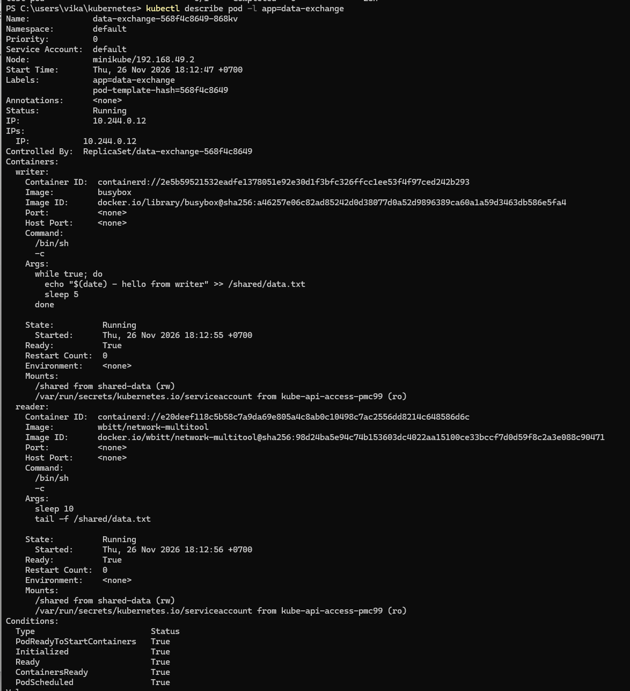
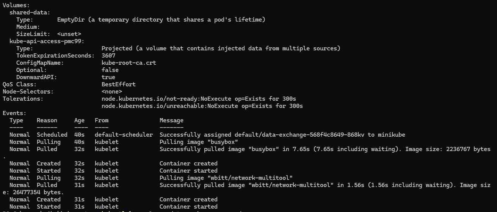
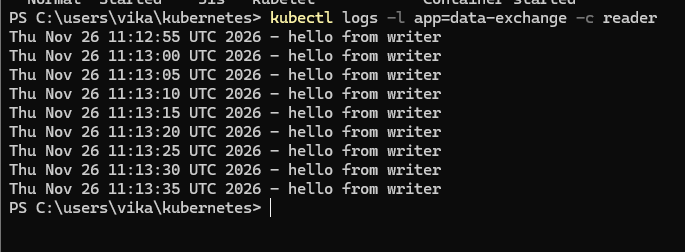
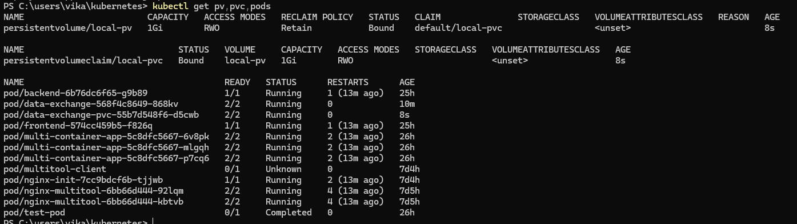
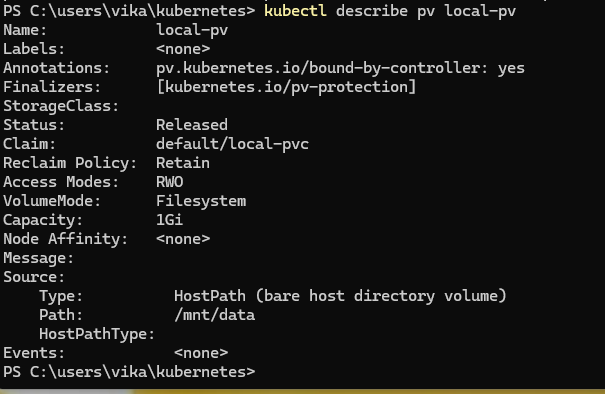
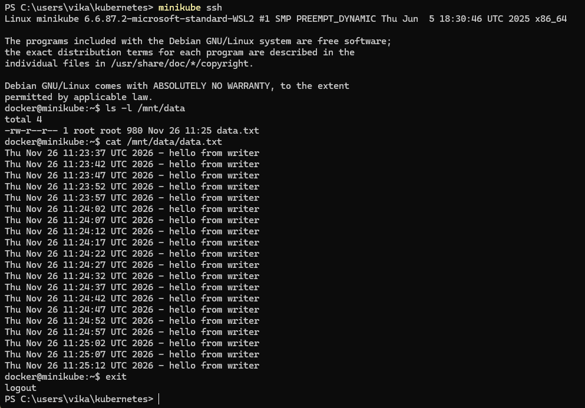
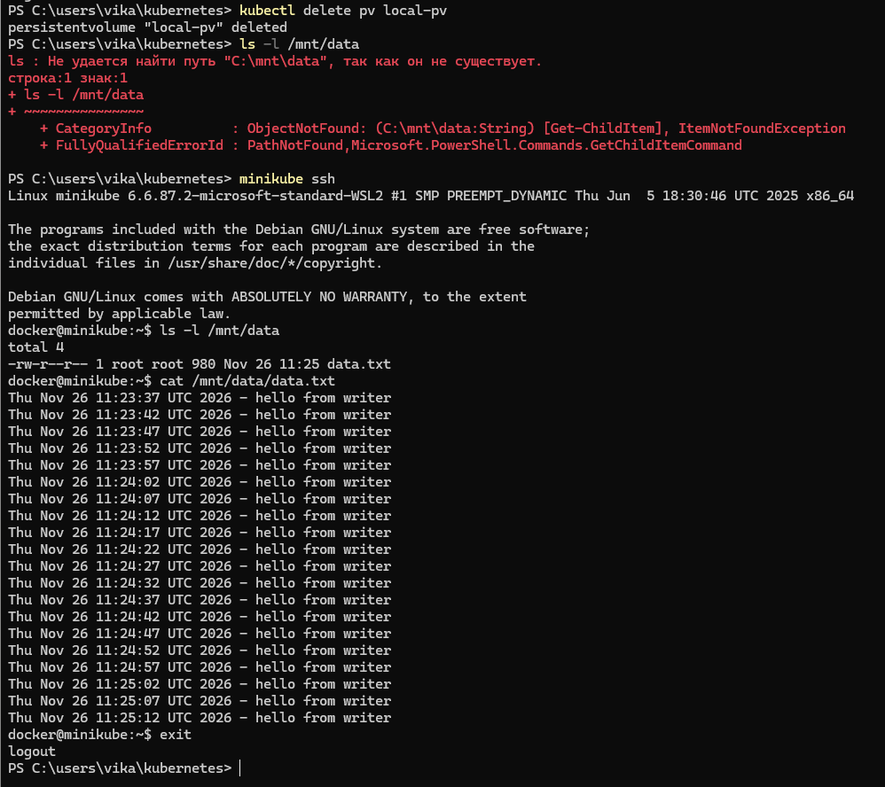
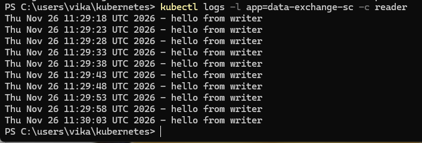

# Домашнее задание к занятию «Хранение в K8s»

## Задание 1. Volume: обмен данными между контейнерами в поде

### Манифест
- [containers-data-exchange.yaml](https://github.com/ryltsevavikyla-coder/kubernetes_3/blob/main/containers-data-exchange.yaml)

### Скриншоты

**Описание пода:**

**Логи reader:**

---

## Задание 2. PV и PVC

### Манифест
- [pv-pvc.yaml](https://github.com/ryltsevavikyla-coder/kubernetes_3/blob/main/pv-pvc.yaml)

### Скриншоты и пояснения

**PV и PVC в статусе Bound, под Running:**

**После удаления Deployment и PVC — PV в статусе Released:**

Пояснение: политика `Retain` не удаляет PV автоматически при удалении PVC. PV переходит в статус `Released`.

**Файл на ноде до удаления PV:**

**Файл на ноде после удаления PV:**

Пояснение: при использовании `hostPath` + политика `Retain` удаление PV не удаляет данные с диска ноды. Файл остаётся, пока его не удалят вручную на самой ноде.

---

## Задание 3. StorageClass

### Манифест
- [sc.yaml](https://github.com/ryltsevavikyla-coder/kubernetes_3/blob/main/sc.yaml)

### Скриншоты

**Логи reader:**

